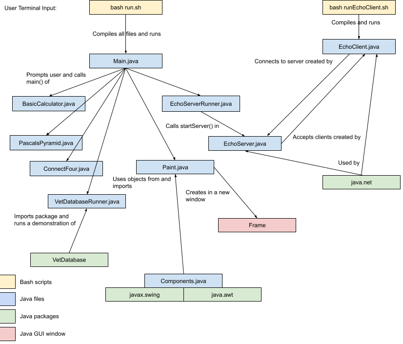

# My Purdue Projects
A repository of some of the coding projects and assignments I've created that I am particularly proud of.

### The Problem
As part of Purdue's CS180, I have completed several programs for assignments that I don't want lost once I complete the class and maybe lose access to the LMS that is used in that class. So, I decided to create this project to keep track of them and make them easier to revisit in the future. The aim was NOT to correct any of the bugs within them, instead, they are presented as-is, and virtually untouched.

### How It Works
This is essentially a program that makes it easier for the user to call the main() methods of other java files. Main.java exists for this purpose, while most other functionalities are contained within other files. For the most part, their names are self-describing.

Main, VetDatabaseRunner, EchoServerRunner, and EchoServerClient.java are the only java files that were written specifically for this project.
run.sh is a script to compile and run all files, and runEchoClient.sh is similarly a script to compile and run EchoClient.java.
BasicCalculator, PascalsPyramid, ConnectFour, and Paint.java are all interactive for the user, and operate with inputs from the command line besides Paint.java, which opens a new window.
VetDatabaseRunner runs a demonstration of the VetDatabase package, while EchoServerRunner is also a demonstration of EchoServer.java

Program diagram:

### Tech Stack
- JDK for Java
- Java as primary language
- Bash for compile and run scripts
- java.net for sockets and serverSockets
- javax.swing for GUI
- java.awt for GUI events
- No data storage

### Setup
Required: Git, Java Development Kit, and ability to run bash scripts in terminal
1. Open the terminal and type "git clone https://github.com/mars-dl/MyPurdueProjects.git"
2. Change directory to MyPurdueProjects/src
3. Type in "bash run.sh"
4. Follow menu directions and prompts, for the most part, these will be number inputs when navigating the menu

### Development Roadmap
-[x] Add two projects
-[x] Add more projects
-[ ] Add functionality not through the command line
-[ ] Add ability to print files line-by-line, independent of file path

### Demo
link